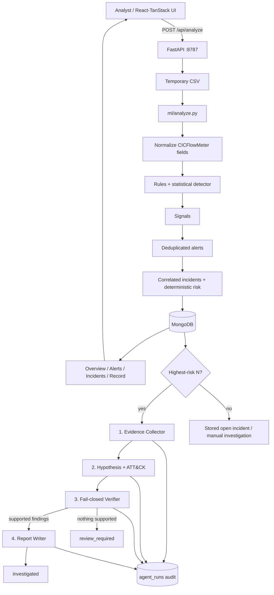

# AI-SOC — Current Architecture

This file documents the **active runtime**, not the older Supabase/Node prototype.

## Detection plane

The uploaded file must be a CICIDS/CICFlowMeter-style network-flow CSV. Header aliases
are normalized into a small canonical schema. Behavioural/statistical detectors create
signals, alerts and correlated incidents.

**Detection is not limited by the LLM quota. Every discovered incident is persisted.**

## Investigation plane

The backend sorts incidents by risk and automatically investigates at most
`MAX_AI_INCIDENTS`. `AGENT_CONCURRENCY` bounds simultaneous incident workflows.

Fixed LangGraph traversal:

`START -> collect -> hypothesize -> verify -> write_report -> END`

The report writer is fail-closed: it is skipped when no hypothesis survives
verification. Agent executions are persisted in `agent_runs` with status, citations,
token count and latency.

## Evidence grounding

Evidence is incident-scoped through `alerts.event_ids`. Each evidence record contains
`source_event_ids`. Supported hypotheses must cite evidence that resolves back to real
source events. The verifier also checks detector/ATT&CK consistency before entailment.

## Persistence

MongoDB collections:

- `ingest_batches`
- `events`
- `signals`
- `alerts`
- `incidents`
- `incident_entities`
- `evidence`
- `agent_runs`
- `incident_timeline`
- `detection_rules`
- `attack_kb`

## Deep learning

The MLP in `ml/train_mlp.py` is an offline academic evaluation artifact. It is not
used to make live runtime decisions.

## Scope boundary

AI-SOC is a network-flow research prototype, not a universal SIEM. Kafka-scale
streaming, endpoint agents, production authentication, arbitrary JSON/Syslog ingestion,
automatic containment and live-served neural-network inference remain future work.
